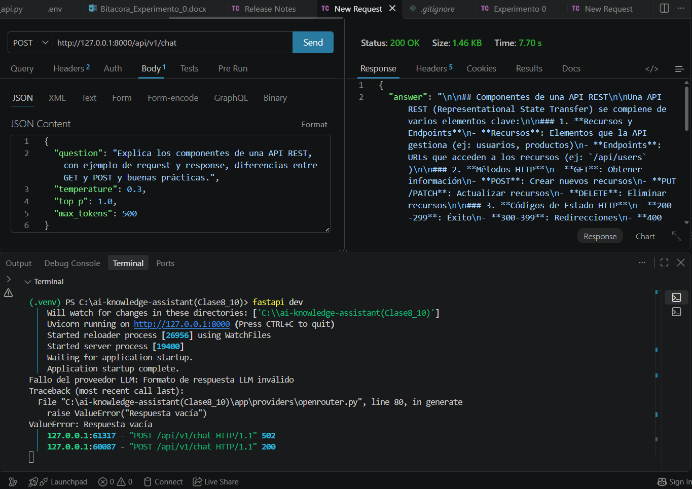
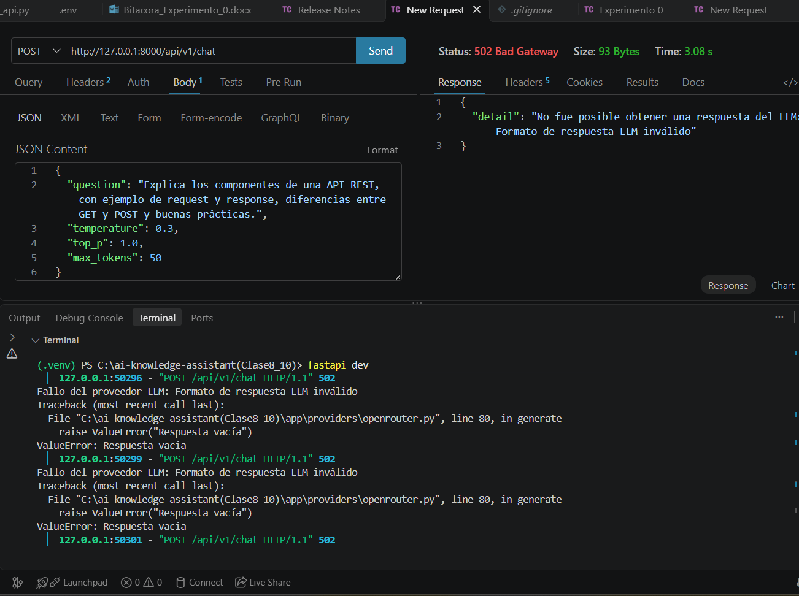
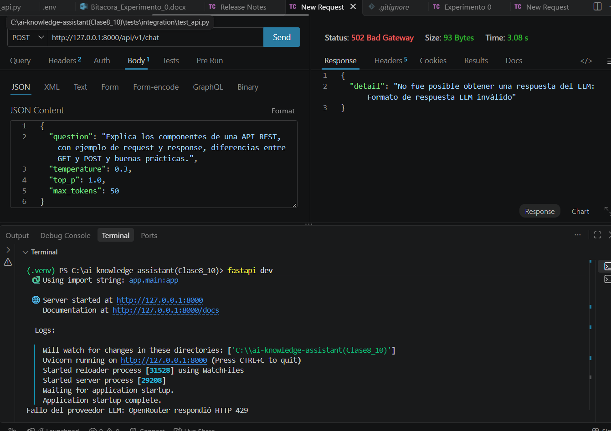

# Experimento 2 · Límite de salida

**Módulo I · Laboratorio con LLM**

| Campo | Información |
|---|---|
| Nombre | Valentina Mendivil Correa |
| Fecha | 21/10/2026 (llamadas entre las 19:28 y las 19:34, hora de Bogotá) |
| Repositorio | https://github.com/MendVal/ai-knowledge-assistant |
| Rama | `feat/module-1-llm-integration` |
| Herramienta | Thunder Client (VS Code) contra `http://127.0.0.1:8000/api/v1/chat` |

## 1. Objetivo y condiciones

Observar cómo cambia la respuesta cuando se limita la salida con `max_tokens` (50, 150 y 500), manteniendo todo lo demás igual.

| Condición | Valor |
|---|---|
| Pregunta fija | Explica los componentes de una API REST, con ejemplo de request y response, diferencias entre GET y POST y buenas prácticas. |
| temperature / top_p | 0.3 / 1.0 |
| max_tokens | 50, 150 y 500 (una llamada por valor) |
| Modelo | Un solo modelo para las tres llamadas. Por la configuración del `.env` durante la prueba debería ser `dots-studio/dots-3-note-preview:free`, **pero el campo `model` de la respuesta no quedó visible en las capturas** (pendiente de confirmar). |
| Prompt de sistema | Eres AI Knowledge Assistant, un asistente educativo especializado en tecnología. Responde en español claro. Explica los conceptos con ejemplos sencillos. Si no tienes suficiente información, indícalo. No inventes referencias ni datos. |

## 2. Bitácora de llamadas

| ID | T | Top-p | Max | Status | Seg. | Tamaño | Observaciones |
|---|---|---|---|---|---|---|---|
| 2-500 | 0.3 | 1.0 | 500 | 200 | 7.70 | 1.46 KB | Respuesta larga y estructurada en Markdown: "Componentes de una API REST", con recursos y endpoints, métodos HTTP (GET, POST, PUT/PATCH, DELETE) y códigos de estado (200-299, 300-399, 400…). El texto completo no quedó registrado (ver pendientes). |
| 2-150 | 0.3 | 1.0 | 150 | 502 | Sin dato | 93 bytes | `Respuesta vacía` según la terminal. No se guardó captura de este intento. |
| 2-50 | 0.3 | 1.0 | 50 | 502 | 3.08 | 93 bytes | `Respuesta vacía`; 3 intentos seguidos con el mismo resultado (ver capturas). |

### Evidencia en la terminal

- En los intentos con `max_tokens` 50, la terminal muestra `ValueError: Respuesta vacía` (`app/providers/openrouter.py`, línea 80) y el router responde 502: "No fue posible obtener una respuesta del LLM: Formato de respuesta LLM inválido".
- Después de varios intentos seguidos apareció en la terminal `Fallo del proveedor LLM: OpenRouter respondió HTTP 429`: se superó el límite de llamadas de la cuenta gratuita (20 por minuto y 50 por día). Es el caso D de la guía: el adaptador convierte el 429 en `LLMProviderError` y el router lo devuelve como 502 sin exponer la API key.

### Capturas

| Llamada | Captura |
|---|---|
| 2-500, 200 |  |
| 2-50, 502 (3 intentos con `Respuesta vacía`) |  |
| 2-50, 502 y luego HTTP 429 en la terminal |  |

## 3. Tabla de resultados

| max_tokens | ¿Respuesta completa? | Duración observada | ¿Qué se omitió? |
|---|---|---|---|
| 50 | No. No hubo respuesta (502, contenido vacío) | 3.08 s | Todo: no se entregó ningún texto |
| 150 | No. No hubo respuesta (502, contenido vacío) | Sin dato (sin captura) | Todo: no se entregó ningún texto |
| 500 | Por verificar. Respondió 200 con 1.46 KB; en la parte visible aparecen componentes, métodos HTTP y códigos de estado | 7.70 s | Pendiente: falta revisar el texto completo para saber si incluyó el ejemplo de request y response, GET vs POST y buenas prácticas |

## 4. Discusión

`max_tokens` limita la cantidad de tokens que el modelo puede generar, pero no garantiza una longitud de texto exacta ni que la respuesta agote ese límite. En este experimento, bajar el límite no produjo respuestas más cortas sino **ninguna respuesta**: con 50 y con 150 tokens el contenido llegó vacío. Una explicación probable es que este modelo gasta parte de los tokens en razonamiento interno antes de escribir, y con un tope tan bajo se acaban antes de que aparezca texto. Es una hipótesis: la API no devuelve el número de tokens usados ni el motivo de finalización, así que no puedo confirmarla.

Además, la duración parece crecer con la cantidad de tokens generados: 3.08 s con límite 50 y 7.70 s con límite 500, aunque solo hay una medición por valor. Y como los tres resultados salen de un solo modelo gratuito y no son pruebas estadísticas, no se pueden generalizar.

Para comprobar la hipótesis, mediría los tokens usados y el costo real leyendo el campo `usage` y el `finish_reason` de la respuesta de OpenRouter dentro del adaptador, sin cambiar la API pública (el cliente seguiría recibiendo `answer` y `model`).

## 5. Pendientes por completar

- Confirmar el campo `model` de la respuesta de 500.
- Pegar el texto completo de la respuesta de 500 y verificar qué partes del tema cubrió.
- Captura del 502 de 150 con el tiempo a la vista.

**Límites del experimento:** una sola llamada por valor de `max_tokens`; modelo gratuito que puede fallar de forma intermitente; sin información de tokens usados ni del motivo de finalización; y el límite de llamadas de la cuenta gratuita se alcanzó durante la prueba.
