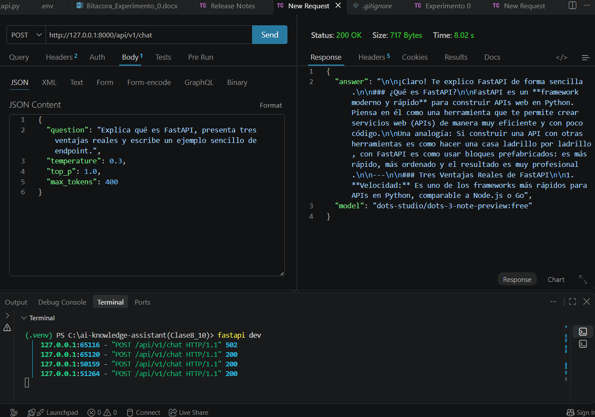
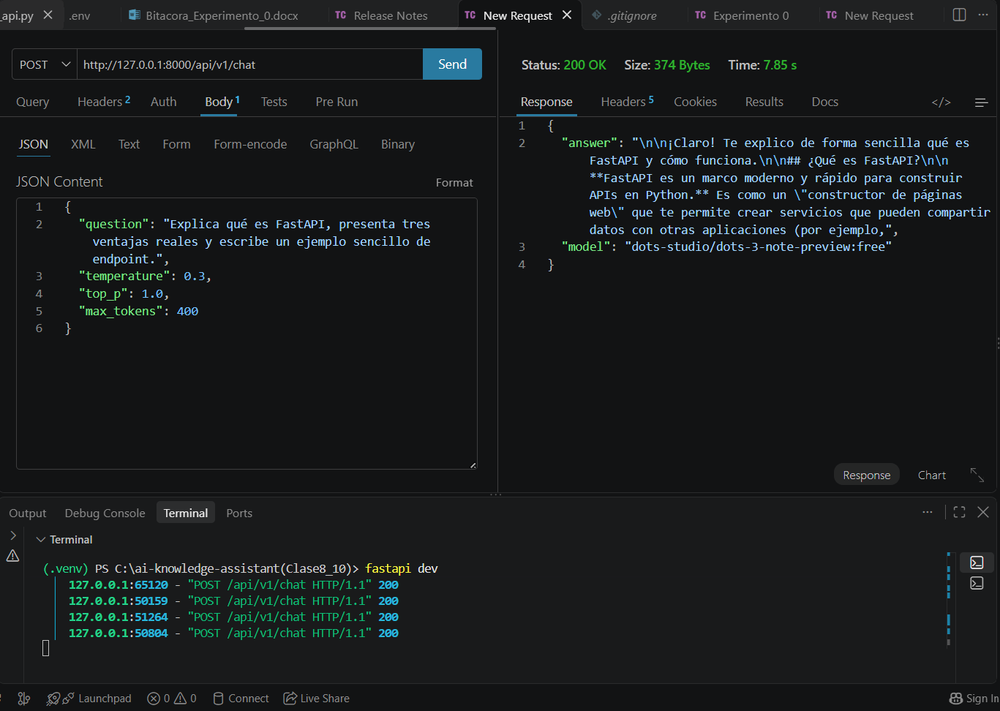
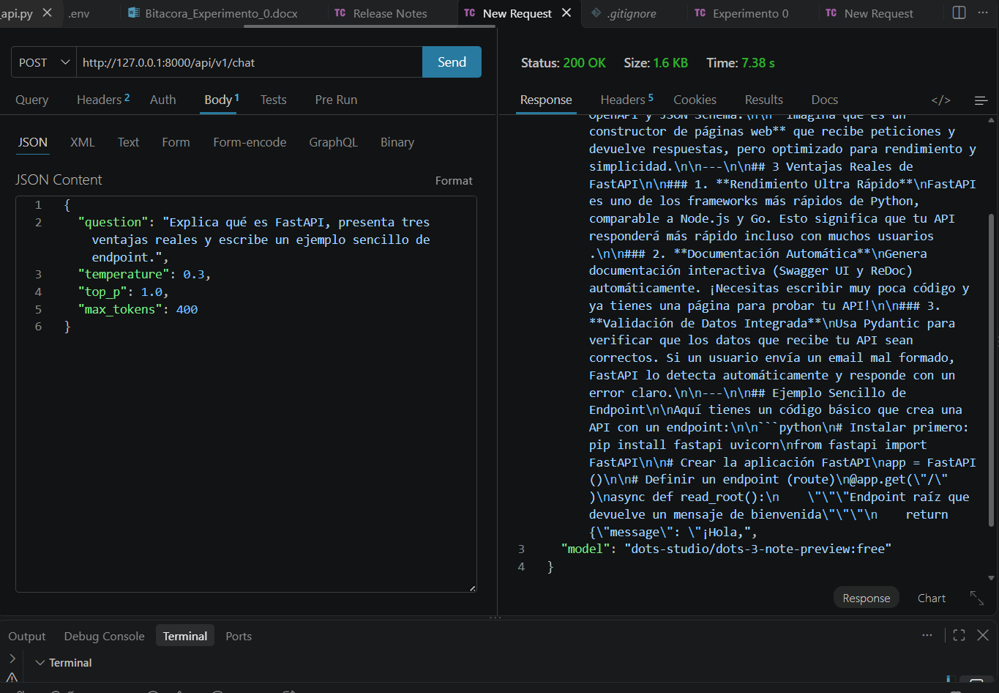
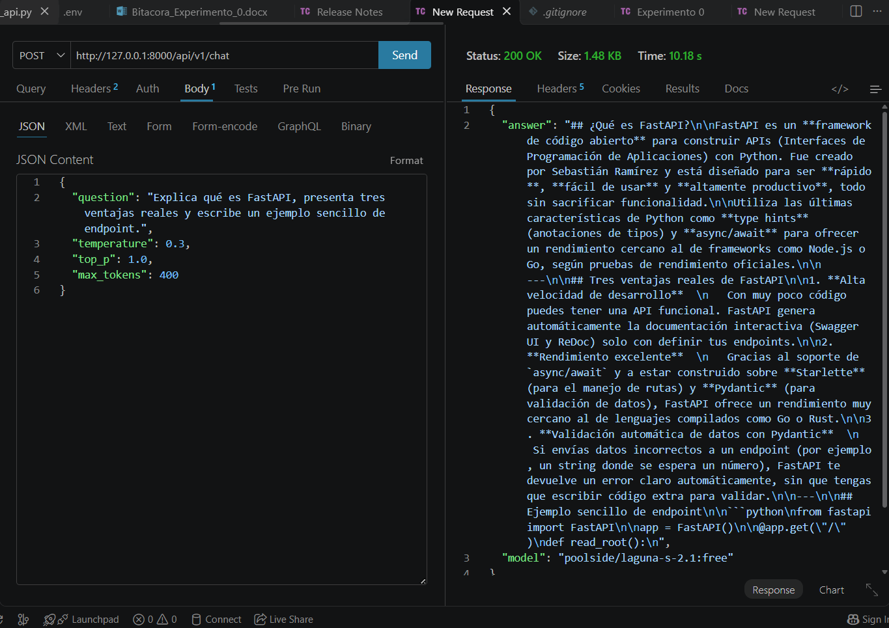
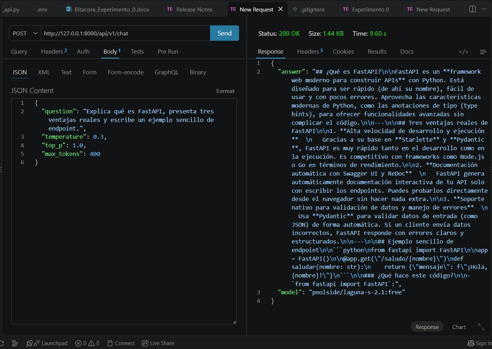
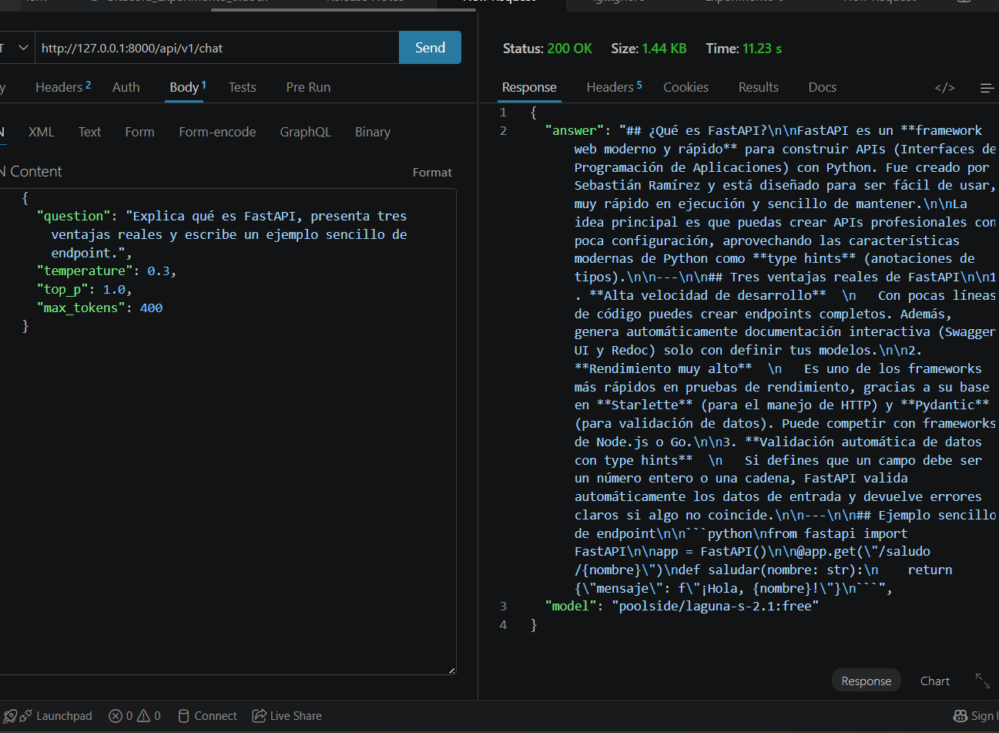
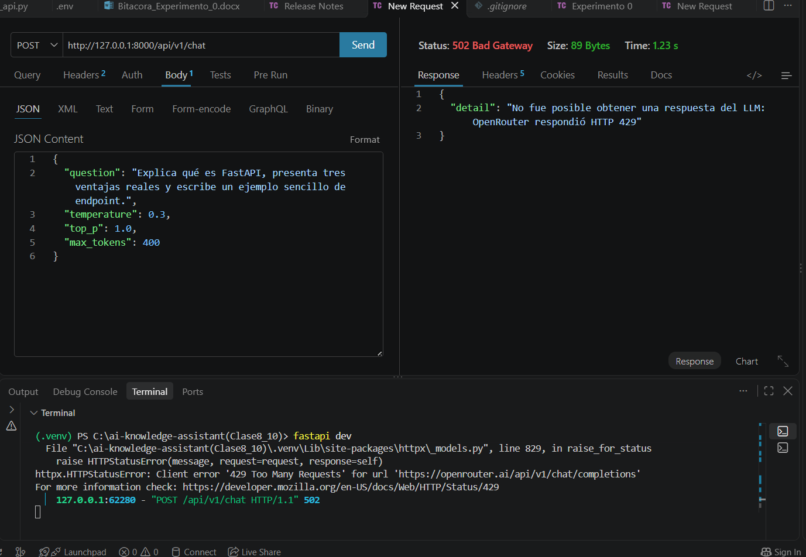

# Experimento 3 · Comparación entre dos modelos

**Módulo I · Laboratorio con LLM**

| Campo | Información |
|---|---|
| Nombre | Valentina Mendivil Correa |
| Fecha | 21/10/2026 (llamadas entre las 19:55 y las 20:06, hora de Bogotá) |
| Repositorio | https://github.com/MendVal/ai-knowledge-assistant |
| Rama | `feat/module-1-llm-integration` |
| Herramienta | Thunder Client (VS Code) contra `http://127.0.0.1:8000/api/v1/chat` |

## 1. Objetivo y condiciones

Comparar dos identificadores concretos de modelo accesibles en OpenRouter, con el mismo prompt y las mismas condiciones, y analizar diferencias de exactitud, claridad, cumplimiento de instrucciones, tiempo y fallos.

| Condición | Valor |
|---|---|
| **Modelo A** | `dots-studio/dots-3-note-preview:free` |
| **Modelo B** | `poolside/laguna-s-2.1:free` |
| Pregunta idéntica | Explica qué es FastAPI, presenta tres ventajas reales y escribe un ejemplo sencillo de endpoint. |
| temperature / top_p / max_tokens | 0.3 / 1.0 / 400 |
| Solicitudes | 3 válidas por modelo |
| Prompt de sistema | Eres AI Knowledge Assistant, un asistente educativo especializado en tecnología. Responde en español claro. Explica los conceptos con ejemplos sencillos. Si no tienes suficiente información, indícalo. No inventes referencias ni datos. |
| Control del modelo | Se usaron IDs explícitos (no `openrouter/free`). El campo `model` de cada respuesta coincide con el ID configurado. |

Antes de experimentar se consultó el catálogo de OpenRouter: ambos modelos aparecen como gratuitos, de solo texto (el A también acepta imagen) y con soporte de `temperature`, `top_p` y `max_tokens`. Los dos admiten modo `reasoning`. Límites del plan gratuito: 20 solicitudes por minuto y 50 por día.

## 2. Bitácora de llamadas

| ID | Modelo exacto | T | Top-p | Max | Status | Seg. | Tamaño | Archivo | Observaciones |
|---|---|---|---|---|---|---|---|---|---|
| A1 | `dots-studio/dots-3-note-preview:free` | 0.3 | 1.0 | 400 | 200 | 8.02 | 717 B | [`exp3_A1.txt`](respuestas/exp3_A1.txt) | Explica qué es FastAPI y llega a la ventaja 1; se corta. No incluye endpoint. |
| A2 | `dots-studio/dots-3-note-preview:free` | 0.3 | 1.0 | 400 | 200 | 7.85 | 374 B | [`exp3_A2.txt`](respuestas/exp3_A2.txt) | Solo la introducción; se corta antes de las ventajas. |
| A3 | `dots-studio/dots-3-note-preview:free` | 0.3 | 1.0 | 400 | 200 | 7.38 | 1.6 KB | [`exp3_A3.txt`](respuestas/exp3_A3.txt) | 3 ventajas y ejemplo de endpoint; se corta en medio del `return`. |
| B1 | `poolside/laguna-s-2.1:free` | 0.3 | 1.0 | 400 | 200 | 10.18 | 1.48 KB | [`exp3_B1.txt`](respuestas/exp3_B1.txt) | 3 ventajas; el ejemplo se corta en `def read_root():`. |
| B2 | `poolside/laguna-s-2.1:free` | 0.3 | 1.0 | 400 | 200 | 9.60 | 1.44 KB | [`exp3_B2.txt`](respuestas/exp3_B2.txt) | 3 ventajas y endpoint completo (`/saludo/{nombre}`); se corta en la explicación posterior. |
| B3 | `poolside/laguna-s-2.1:free` | 0.3 | 1.0 | 400 | 200 | 11.23 | 1.44 KB | [`exp3_B3.txt`](respuestas/exp3_B3.txt) | 3 ventajas y endpoint completo; termina al cerrar el bloque de código, sin explicación. |
| B-429 | `poolside/laguna-s-2.1:free` | 0.3 | 1.0 | 400 | 502 | 1.23 | 89 B | (captura) | OpenRouter respondió HTTP 429 antes de la primera respuesta válida. |

Nota: los textos están transcritos de las capturas de Thunder Client. En A3 el inicio de la respuesta no era visible (el panel estaba desplazado). En la terminal de la captura A1 se ve además un 502 anterior a la primera respuesta válida del modelo A, cuya causa no quedó registrada.

### Capturas

| Llamada | Captura |
|---|---|
| A1 |  |
| A2 |  |
| A3 |  |
| B1 |  |
| B2 |  |
| B3 |  |
| B, HTTP 429 |  |

## 3. Tabla comparativa

Puntuaciones de 1 a 5 según el criterio explicado abajo; son una valoración mía sobre solo 3 respuestas por modelo, no una medición exacta.

| Criterio | Modelo A (`dots-3-note-preview`) | Modelo B (`laguna-s-2.1`) |
|---|---|---|
| Exactitud técnica (1-5) | **3** | **4** |
| Claridad pedagógica (1-5) | **3** | **4** |
| Cumplimiento de instrucciones (1-5) | **2** | **4** |
| Tiempo promedio (s) | **7.75** (8.02, 7.85 y 7.38) | **10.34** (10.18, 9.60 y 11.23) |
| Fallos / truncamiento | 3 de 3 truncadas; 2 de 3 sin las tres ventajas; 1 de 3 con endpoint (cortado); un 502 previo | 3 de 3 terminan sin cierre natural; 1 de 3 se corta dentro del código; 2 de 3 con endpoint completo; un 429 previo |

**Criterio de las puntuaciones:**
- *Exactitud:* ambos modelos describen bien FastAPI (Starlette, Pydantic, documentación Swagger/ReDoc, type hints). El A llama a FastAPI "constructor de páginas web", una analogía imprecisa porque construye APIs. Los dos exageran con el rendimiento ("comparable a Node.js o Go"; el B1 llega a decir "muy cercano a Go o Rust"). El B aporta datos verificables como el creador (Sebastián Ramírez).
- *Claridad:* el B mantiene en las tres respuestas la misma estructura (definición, tres ventajas, ejemplo). El A es claro cuando llega a la ventaja, pero A1 y A2 se quedan en la introducción.
- *Cumplimiento:* la instrucción tenía tres partes (explicar, tres ventajas, ejemplo de endpoint). El A cumplió las tres partes en 1 de 3 respuestas (y el ejemplo salió cortado); el B dio las tres ventajas en 3 de 3 y un endpoint ejecutable en 2 de 3.

## 4. Análisis

El modelo B (`laguna-s-2.1`) cumplió mejor la tarea con el mismo límite de 400 tokens, pero fue más lento (10.34 s frente a 7.75 s de promedio). El modelo A fue más rápido porque sus respuestas se cortan antes: cuanto menos texto llega, menos tarda. No se puede concluir que el A "sea más veloz", solo que entregó menos contenido en esas llamadas.

Ambos modelos truncan su salida y ambos tuvieron un fallo antes de responder (un 502 en el A y un 429 en el B). Con `max_tokens` 400 el A casi nunca llegó al ejemplo de endpoint, algo coherente con lo visto en el Experimento 2, donde con límites bajos este modelo devolvía contenido vacío; una explicación posible, no comprobada, es que el modelo consume parte de los tokens en razonamiento interno.

**Control crítico:** se usaron IDs explícitos y el campo `model` de cada respuesta coincide con el configurado, así que los resultados pueden atribuirse a esos modelos. La API no informa si el proveedor sirvió otra variante.

**Límites del experimento:** solo 3 respuestas por modelo, una única pregunta y valoraciones subjetivas; modelos gratuitos con fallos intermitentes y límites de uso; las llamadas se hicieron en momentos distintos; y no hay datos de tokens usados ni del motivo de finalización de cada respuesta.
