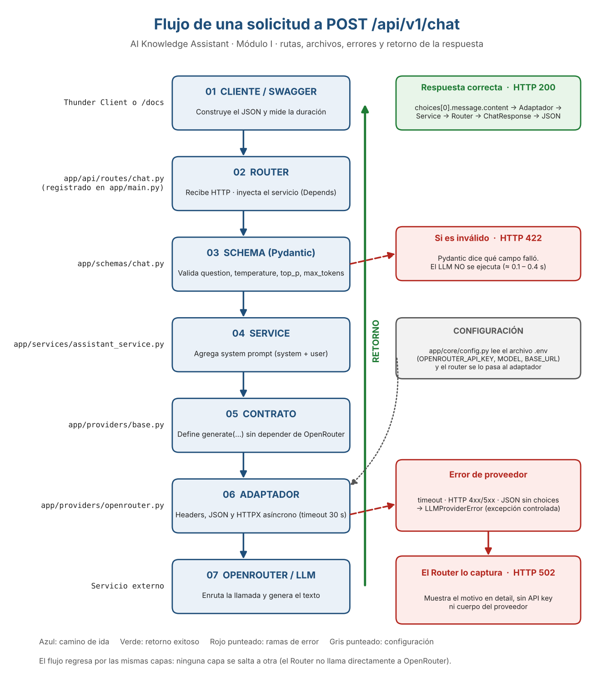

# Diagrama anotado, preguntas A–F y fallos simulados

**Módulo I · Laboratorio con LLM**

Valentina Mendivil Correa · 21/10/2026 · Rama `feat/module-1-llm-integration`

## 1. Diagrama de flujo anotado

**Cómo leerlo:** 1) el cliente envía el JSON; 2) el router recibe la petición y, con `Depends`, arma el servicio y el adaptador con la configuración de `.env`; 3) Pydantic valida los datos (si fallan, responde **422** sin llamar al LLM); 4) el servicio agrega el prompt de sistema; 5) el contrato `LLMProvider` define `generate(...)`; 6) el adaptador arma el request y lo envía con HTTPX; 7) OpenRouter genera el texto. La respuesta vuelve por las mismas capas; si el proveedor falla, el adaptador lanza `LLMProviderError` y el router responde **502**.

## 2. Preguntas para responder con evidencia

### A. ¿En qué archivo se modifica la instrucción de sistema?

**Respuesta:** En app/services/assistant_service.py, en la constante SYSTEM_PROMPT. El servicio la agrega como mensaje "system" antes del mensaje "user" con la pregunta.

**Evidencia:** Test unitario test_ask_builds_system_and_user_messages: verifica que el primer mensaje es el system prompt y el segundo es la pregunta del usuario.

### B. ¿Dónde se agrega la API key?

**Respuesta:** En el archivo .env (variable OPENROUTER_API_KEY), nunca en el código. app/core/config.py lo lee con load_dotenv y os.getenv; el router (get_assistant_service) se lo pasa al adaptador OpenRouterProvider, que la envía en el header Authorization. El .gitignore excluye .env y en el repositorio solo hay una plantilla, env.example, sin clave.

**Evidencia:** Sin la clave, el adaptador lanza "No se configuró OPENROUTER_API_KEY" (test_generate_without_api_key). Además, test_502_does_not_leak_api_key comprueba que la clave no aparece en la respuesta de error.

### C. ¿Qué parte rechaza temperature = -1?

**Respuesta:** Pydantic, en app/schemas/chat.py: el campo temperature está definido con ge=0 (y le=1.5). La validación ocurre en la capa de schema, antes de llegar al servicio y al proveedor.

**Evidencia:** Experimento 0: HTTP 422, type greater_than_equal, loc body.temperature, en 0.119 s (la línea base tardó 8.05 s). Test test_chat_rejects_negative_temperature: el proveedor falso no recibió ninguna llamada (provider.calls == []).

### D. ¿Qué sucede si OpenRouter responde 429?

**Respuesta:** En el adaptador (app/providers/openrouter.py), raise_for_status lanza HTTPStatusError y se convierte en LLMProviderError("OpenRouter respondió HTTP 429"). El router (app/api/routes/chat.py) captura esa excepción, la registra en el log y responde HTTP 502 con el motivo en detail. El cliente no recibe el 429 original ni el cuerpo del proveedor.

**Evidencia:** Tests test_generate_http_429 (adaptador) y test_chat_returns_502_on_provider_error (API). Caso real: con un modelo que ya no existía, OpenRouter devolvió 404 y la API respondió 502 de 89 bytes en 2.17 s.

### E. ¿Qué archivo modificarías para sustituir el proveedor?

**Respuesta:** Crearía un adaptador nuevo en app/providers/ que cumpla el contrato LLMProvider (app/providers/base.py) y cambiaría la función get_assistant_service del router para que construya ese adaptador. El servicio, los schemas y el contrato no cambian, porque el servicio solo conoce provider.generate(...).

**Evidencia:** FakeLLMProvider (app/providers/fake.py) sustituye a OpenRouter en las pruebas sin tocar el servicio: test_ask_returns_provider_answer pasa con el proveedor falso.

### F. ¿Por qué el flujo regresa por las mismas capas?

**Respuesta:** Porque cada capa solo conoce a la vecina y cada una traduce el resultado a su nivel: el adaptador extrae el texto o lanza un error controlado, el servicio entrega el texto, el router lo convierte en ChatResponse o en un código HTTP (200 o 502) y FastAPI lo serializa a JSON. Si una capa se saltara a otra, se perdería esa separación (por ejemplo, el router llamaría directo a OpenRouter).

**Evidencia:** Los errores siguen el mismo camino de regreso: adaptador → LLMProviderError → router → 502 (ver diagrama).

## 3. Experimento 5 · Manejo de fallos sin consumo externo

Se usaron pruebas con el transporte HTTP simulado (`httpx.MockTransport`) y con un `FakeLLMProvider`, por lo que no se gastó ninguna llamada real a OpenRouter. Ejecución: `python -m pytest -v` → **16 passed**.

| Caso simulado | Salida esperada de la API | Prueba y evidencia | Resultado |
|---|---|---|---|
| Timeout HTTPX | 502 | test_generate_timeout: el adaptador lanza LLMProviderError("Tiempo de espera agotado"). test_chat_returns_502_on_provider_error: el router traduce LLMProviderError a 502. | PASSED |
| HTTP 429 del proveedor | 502 | test_generate_http_429: LLMProviderError con "429". test_502_does_not_leak_api_key: la respuesta 502 no contiene la clave ni el cuerpo del proveedor. | PASSED |
| JSON sin choices | 502 | test_generate_response_without_choices: LLMProviderError("Formato de respuesta LLM inválido"). Mismo manejo del router (502). | PASSED |

### Fallos reales observados durante el laboratorio

| Situación | Qué pasó |
|---|---|
| Modelo minimax-m3.1-flash:free | Respuesta vacía: ValueError "Respuesta vacía" → LLMProviderError("Formato de respuesta LLM inválido"). El router lo registró como "Fallo del proveedor LLM". El modelo probablemente gastó los 300 tokens razonando. |
| Modelo meta-llama/llama-3.3-70b-instruct:free | OpenRouter respondió 404 (el modelo ya no estaba disponible). La API devolvió 502 Bad Gateway, 89 bytes, 2.17 s. Este modelo no figuraba en el catálogo gratuito consultado ese día. |

Estos dos casos reales confirman el comportamiento simulado: el proveedor falló y la API respondió con un error controlado en lugar de caerse.
