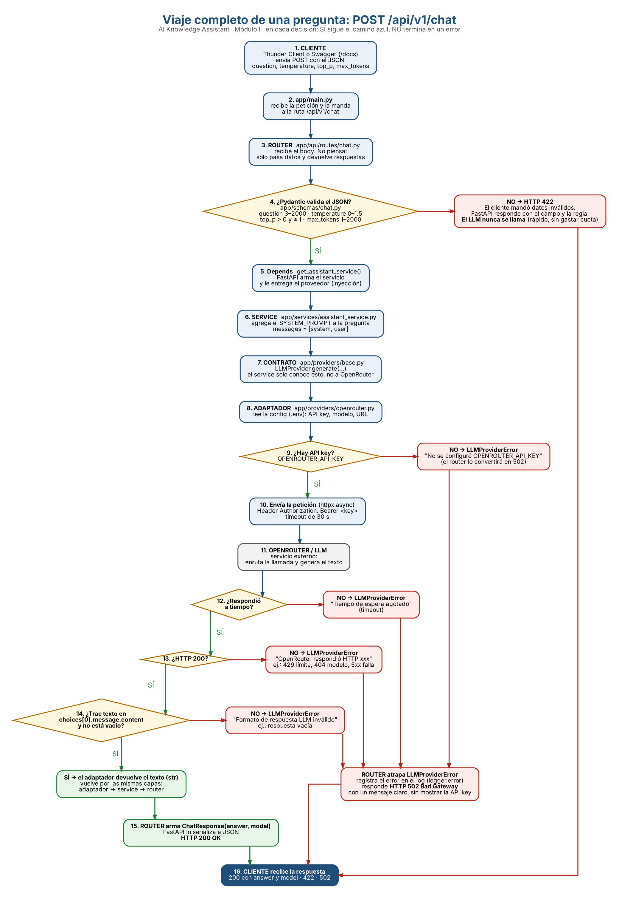

# Esquema del viaje de una pregunta (qué pasa si SÍ y qué pasa si NO)

**Módulo I · AI Knowledge Assistant · POST /api/v1/chat**

## 1. Cómo leer el esquema

- **Camino azul:** el recorrido normal, capa por capa, de arriba hacia abajo.
- **Rombos amarillos:** decisiones. Si la respuesta es **SÍ** (flecha verde), sigue. Si es **NO** (flecha roja), termina en un error.
- **Cajas rojas:** errores. Todos los del proveedor se convierten en `LLMProviderError` y el router los devuelve como **502**. Los datos inválidos devuelven **422**.
- **Cajas verdes:** el éxito. El texto vuelve por las mismas capas y sale como **200**.

## 2. Paso a paso (qué hace cada parte)

| N.º | Parte | Archivo | Qué hace |
|---|---|---|---|
| 1 | Cliente | Thunder Client o `/docs` | Envía el JSON con `question`, `temperature`, `top_p` y `max_tokens`. |
| 2 | Aplicación | `app/main.py` | Recibe la petición y la dirige a la ruta `/api/v1/chat`. |
| 3 | Router | `app/api/routes/chat.py` | Recibe el body. No piensa: pasa datos y devuelve respuestas. |
| 4 | Schema (Pydantic) | `app/schemas/chat.py` | Valida el JSON. Es la decisión que corta primero. |
| 5 | Depends | `get_assistant_service()` | FastAPI arma el servicio con su proveedor (inyección de dependencias). |
| 6 | Service | `app/services/assistant_service.py` | Agrega el `SYSTEM_PROMPT` y arma los mensajes `[system, user]`. |
| 7 | Contrato | `app/providers/base.py` | `LLMProvider.generate(...)`: lo único que el service conoce del proveedor. |
| 8 | Adaptador | `app/providers/openrouter.py` | Lee la config (`.env`) y habla con OpenRouter. |
| 9 a 14 | Decisiones del adaptador | `app/providers/openrouter.py` | Revisa la API key, el tiempo, el status HTTP y el contenido de la respuesta. |
| 15 | Router | `app/api/routes/chat.py` | Arma `ChatResponse(answer, model)`; FastAPI lo convierte en JSON. |
| 16 | Cliente | | Recibe 200, 422 o 502. |

## 3. Qué pasa si SÍ y qué pasa si NO

| Decisión | Si SÍ | Si NO | Cómo lo comprobamos |
|---|---|---|---|
| 4. ¿Pydantic valida el JSON? | Sigue al service | **422**. El LLM no se llama | `question = "A"` y `temperature = -1` dieron 422 en 0.377 s y 0.119 s; el proveedor falso quedó con `calls == []` |
| 9. ¿Hay API key? | Envía la petición | `LLMProviderError("No se configuró OPENROUTER_API_KEY")` → **502** | test `test_generate_without_api_key` |
| 12. ¿Respondió a tiempo? (30 s) | Revisa el status | `LLMProviderError("Tiempo de espera agotado")` → **502** | test `test_generate_timeout` (simulado con `httpx.MockTransport`) |
| 13. ¿HTTP 200? | Revisa el contenido | `LLMProviderError("OpenRouter respondió HTTP xxx")` → **502** | caso real: **429** en el laboratorio; **404** con un modelo inexistente; test `test_generate_http_429` |
| 14. ¿Trae texto en `choices[0].message.content`? | Devuelve el texto | `LLMProviderError("Formato de respuesta LLM inválido")` → **502** | caso real: respuesta vacía con `max_tokens` 50 y 150; test `test_generate_response_without_choices` |
| Todo bien | El texto vuelve por adaptador → service → router | | **200** con `answer` y `model` |

## 4. Tres ideas para explicarlo en clase

1. **Cada capa solo conoce a su vecina.** El router no sabe de OpenRouter; el service no sabe de HTTP. Por eso se puede cambiar de proveedor tocando solo el adaptador.
2. **Hay dos tipos de error.** 422 es culpa del cliente (datos inválidos) y se detecta antes de gastar una llamada. 502 es un fallo del proveedor y se controla para que la API no se caiga ni muestre la API key.
3. **La respuesta vuelve por el mismo camino.** Si el texto o el error se saltaran una capa, se perdería la separación de responsabilidades.

## 5. Una aclaración sobre el esquema de la clase

En el esquema que se dibujó en clase aparece que el router "valida variables de entorno y JSON". En este proyecto esas tareas están separadas:

- El **JSON** lo valida **Pydantic** (`app/schemas/chat.py`), no el router.
- Las **variables de entorno** (API key, modelo y URL) las lee `app/core/config.py` desde el `.env`, y el **adaptador** comprueba que la API key exista.
- El **router** solo recibe, llama al servicio y convierte los errores en respuestas HTTP.

Si en la evaluación preguntan quién valida qué, esa es la separación correcta.
